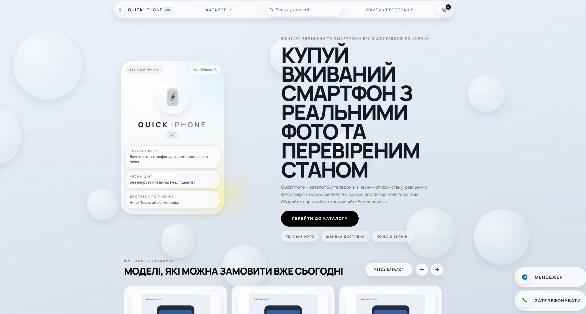
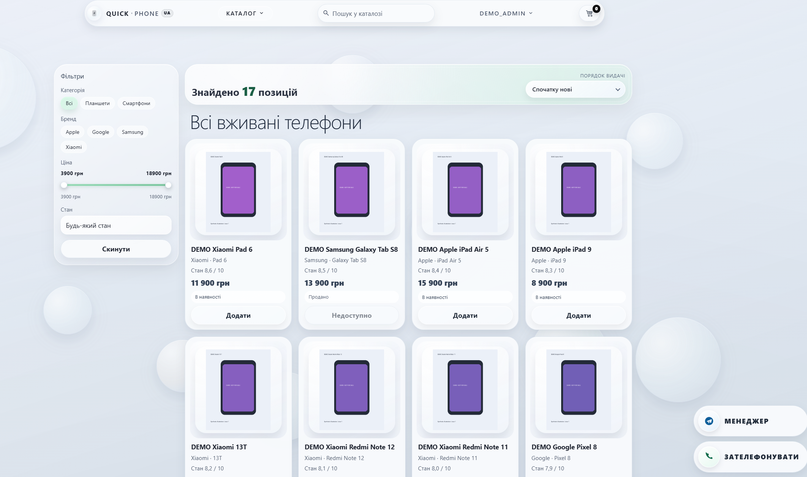
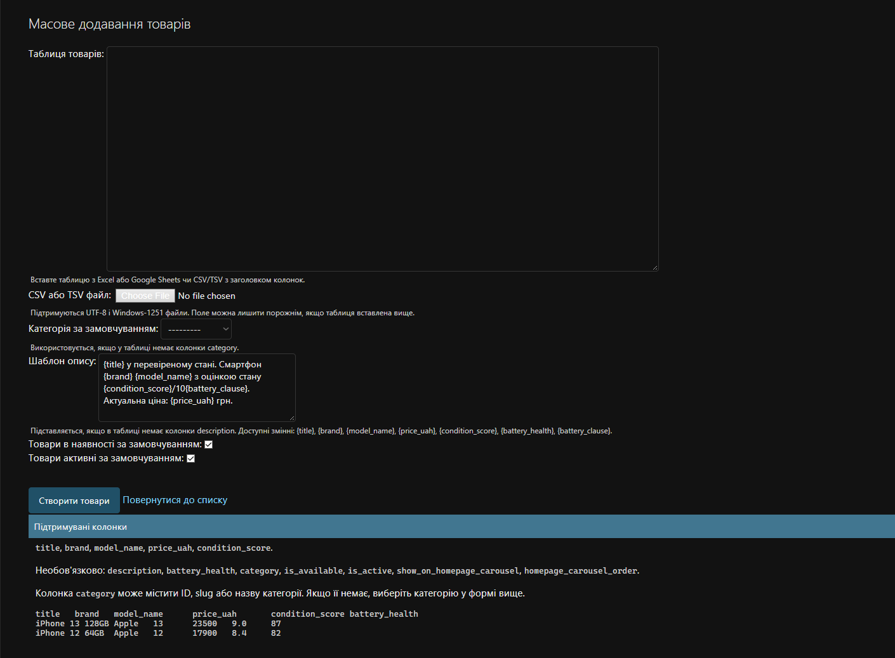

# QuickPhoneUA

A Django store for used smartphones, covering product browsing, checkout, and order management through the admin. Customers can place an order as guests or register to keep track of their orders.

The project focuses on backend work: catalog queries, a session cart, validation, order transactions, phone-based authentication, and a Nova Poshta integration. Django templates render the pages, while HTMX updates individual sections without a full reload. The storefront interface is in Ukrainian.

## Features

- Search by product name, brand, or model; filter by category, price, and condition; sort and browse paginated results.
- Product pages with multiple photos, descriptions, battery health, and model specifications.
- A cart for guests and registered customers, with pickup or Nova Poshta delivery at checkout.
- Phone-based registration and login, profile editing, and personal order history.
- Django admin for products and orders, CSV/TSV imports, multiple image uploads, and homepage product selection.

Orders start with a pending-review status and are handled by a manager. The site does not process online payments.

## Screenshots

### Homepage



### Catalog



### Product import in Django admin



## Backend implementation

The project has three Django apps. `catalog` handles products, search, and imports; `orders` handles the cart, checkout, and delivery; `users` handles authentication, profiles, and SMS verification. Routing and settings live in `site/config/`.

### Catalog and imports

`Product` represents an individual device with its own price, condition, and availability. Photos are stored in `ProductImage`; shared model specifications live in `DeviceModel` and `DeviceModelSpec`. Two phones of the same model can have different prices and condition scores while sharing their specifications.

Search and filters use the Django ORM. Related categories and images are loaded with `select_related` and `prefetch_related`. Database indexes support common lookups, and constraints enforce non-negative prices, condition scores between 0 and 10, and at most one primary image per product.

The importer accepts pasted tables or CSV/TSV files. It validates every row before saving anything. Invalid rows are reported by number; valid tables are saved in a single transaction. A default category and description template can be applied to the whole import.

`Product.phone_number` is a historical field name for a three-digit internal stock number. It is not a customer's phone number; `000` means unassigned.

### Cart and orders

The Django session stores product IDs only. Prices and availability are read from the database. Each listing represents a single phone or tablet, so adding it again does not increase its quantity.

At checkout, the server validates contact details, the delivery method, and product availability. Money is calculated with `Decimal`. The `Order` and its `OrderItem` records are created inside `transaction.atomic()`: a failed write rolls back the order and leaves the cart intact. The cart is cleared after a successful save.

`OrderItem.price_at_order` preserves the price at checkout. Later catalog price changes do not affect an existing order item. Orders placed while signed in are linked to the customer, and the profile queries only that user's orders.

### Delivery

The Nova Poshta integration searches cities and branches and requests a delivery estimate through `getDocumentPrice`. The sender city is Kharkiv. The estimate includes 0.5% of the declared value; a separate `2% + UAH 20` fee is added at checkout. Pickup has no delivery charge or checkout fee.

This is a cost estimate; the site does not create shipping documents. External service errors and timeouts are handled separately from form validation errors.

### Authentication and SMS

The custom user model extends `AbstractUser`. Phone numbers are normalized to `+380XXXXXXXXX`; forms also accept the local format. Password hashing uses Django's built-in tools.

SMS verification is implemented for registration, login after a long absence, password reset, and phone number changes. Verification codes are hashed, expire, have an attempt limit, and cannot be reused after confirmation. Resending is subject to a cooldown.

SMS verification is disabled by default, so registration and login work without a provider. For local testing, codes can be printed to the server console without sending messages.

## Stack

Python 3.11, Django 5.2 LTS, SQLite for local development, and PostgreSQL in the production configuration. Pillow handles images. The interface uses Django Templates, HTMX, JavaScript, and Tailwind CSS 3.

## Run locally

Verified with Python 3.11, Node.js 22, and npm 10. The following commands are for PowerShell:

```powershell
git clone https://github.com/xavqer/QuickPhoneUA.git
cd QuickPhoneUA

py -3.11 -m venv venv
.\venv\Scripts\python.exe -m pip install -r site\requirements.txt

Push-Location site
npm ci
npm run build:css
Pop-Location

$env:DJANGO_SETTINGS_MODULE = "config.settings.local"
.\venv\Scripts\python.exe site\manage.py migrate
.\venv\Scripts\python.exe site\manage.py runserver
```

- Store: http://127.0.0.1:8000/
- Admin: http://127.0.0.1:8000/upravlinnia-mahazynom/
- Demo admin: `demo_admin` / `DemoAdmin-2026!`

The repository includes `site/db.sqlite3` with 18 demo products and images in `site/media/demo/`. There is no need to populate the catalog before the first run. Prices, specifications, and images are synthetic. The demo admin account is for local use only.

No API keys are needed to browse the catalog, register, use the profile and admin, or place a pickup order. HTMX and fonts load from CDNs and require an internet connection.

## Demo deployment

For a hosted demo without an SMS provider, disable registration:

```text
REGISTRATION_ENABLED=false
SMS_VERIFICATION_ENABLED=false
```

With these settings, registration is unavailable and the site explains that SMS verification is not connected. Direct registration requests are also blocked. Catalog browsing and guest checkout remain available. Locally, registration is enabled by default so the account flows can be explored without a provider.

## Integration settings

Available variables are listed in [site/.env.example](site/.env.example). Settings read the process environment; `.env` files are not loaded automatically.

To enable branch lookup and delivery estimates, set your own API key before starting the server:

```powershell
$env:NP_API_KEY = "your-api-key"
```

To test SMS verification through the console:

```powershell
$env:SMS_VERIFICATION_ENABLED = "true"
$env:SMS_VERIFICATION_FAKE_DELIVERY = "true"
$env:SMS_VERIFICATION_TEST_CODE = ""
```

Restart the server after changing these variables. The code appears in its console as `[DEMO SMS]`; enter it in the website form. Real delivery uses SMSClub and requires `SMSCLUB_API_TOKEN`, `SMSCLUB_SENDER_NAME`, and `SMS_VERIFICATION_FAKE_DELIVERY=false`.

The `config.settings.production` configuration uses PostgreSQL, secure cookies, and HTTPS redirects. Set your own `SECRET_KEY`, `ALLOWED_HOSTS`, and database credentials. See the [server update guide](site/docs/operations/production-update-runbook.md).

## Tests

```powershell
.\venv\Scripts\python.exe site\manage.py test apps.catalog apps.orders apps.users --settings=config.settings.local
```

The project has 127 automated tests covering catalog filters, model validation, imports, image uploads, the cart, checkout, profile access, SMS verification, and disabled demo registration. External integrations are mocked, and Django creates a separate test database.

Additional checks:

```powershell
.\venv\Scripts\python.exe site\manage.py check --settings=config.settings.local
.\venv\Scripts\python.exe site\manage.py makemigrations --check --dry-run --settings=config.settings.local
```

## Code entry points

- [catalog/models.py](site/apps/catalog/models.py): products, images, and specifications.
- [catalog/services.py](site/apps/catalog/services.py): import validation and persistence.
- [orders/cart.py](site/apps/orders/cart.py): session cart.
- [orders/views.py](site/apps/orders/views.py): checkout and order creation transaction.
- [orders/np_service.py](site/apps/orders/np_service.py): Nova Poshta requests and delivery estimates.
- [users/forms.py](site/apps/users/forms.py) and [users/services.py](site/apps/users/services.py): authentication and code verification.

The bundled SQLite database is for demonstration. After experimenting with personal data locally, do not commit those database changes.
